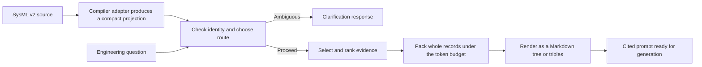

# GraphRAG for SysML v2

Ask engineering questions about an existing SysML v2 model and inspect the
source-backed evidence behind a possible answer. The package implements the
Apollo and Vacuum Routed GraphRAG baseline **`routed-reverse-allocation-2026-11-25`**.
It checks model identities and scope, retrieves cited graph records, and
packs whole evidence units within a token budget. It can return a fixed
clarification or scoped evidence gap before generation.

## Try it

- [Synthetic assembly quick start](CANDIDATE.md) runs the candidate offline
  from a supplied compact projection. Try a part-and-type question and an
  ambiguous name to see both outcomes.
- [Apollo notebook](examples/apollo/Apollo.ipynb) and [setup instructions](examples/apollo/README.md)
  compile the pinned Apollo 11 model and run Text Hybrid, One-Hop, and Routed
  GraphRAG on a question you can change. Inspect each cited prompt and optionally
  generate an answer with local Ollama.
- [Flashlight notebook](examples/flashlight/Flashlight.ipynb) and [setup instructions](examples/flashlight/README.md#run)
  show a compiler-backed example comparing text, one-hop, and bounded graph
  retrieval.

## How the candidate works

The `python -B -m sysml_graphrag` CLI reads an existing compact projection.
It saves exact messages or a fixed response, the route and baseline version,
and token counts. The [candidate guide](CANDIDATE.md#offline-example) has an
offline command you can run with the supplied assembly model.

The Flashlight walkthrough shows source ingestion and
evidence retrieval through its own compiler-backed example. See the
[candidate guide](CANDIDATE.md#external-projections) for the graph input format
and the [walkthrough attribution](examples/flashlight/README.md#attribution) for upstream
inputs.
