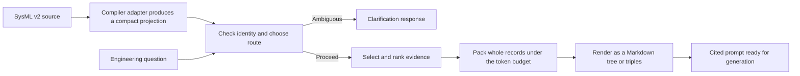

# GraphRAG for SysML v2

Ask engineering questions about an existing SysML v2 model and inspect the
source-backed evidence behind a possible answer. The candidate checks model
identities and scope, retrieves relevant graph records, and packs them into a
token budget. It produces a cited prompt or a clarification request when the
question is ambiguous.

## Try it

- [Synthetic assembly quick start](CANDIDATE.md) runs the candidate offline
  from a supplied compact projection. Try a part-and-type question and an
  ambiguous name to see both outcomes.
- [Apollo notebook](examples/apollo/Apollo.ipynb) and [setup instructions](examples/apollo/README.md)
  compile the pinned Apollo 11 model, build a compact graph, prepare a cited
  prompt, and optionally generate an answer with local Ollama.
- [Flashlight notebook](examples/flashlight/Flashlight.ipynb) and [setup instructions](examples/flashlight/README.md#run)
  show a compiler-backed example comparing text, one-hop, and bounded graph
  retrieval.

## How the candidate works

The `sysml_graphrag` CLI starts with an existing compact projection. It saves the
prompt for inspection. The Flashlight walkthrough shows source ingestion and
evidence retrieval through its own compiler-backed example. See the
[candidate guide](CANDIDATE.md#external-projections) for the graph input format
and the [walkthrough attribution](examples/flashlight/README.md#attribution) for upstream
inputs.
